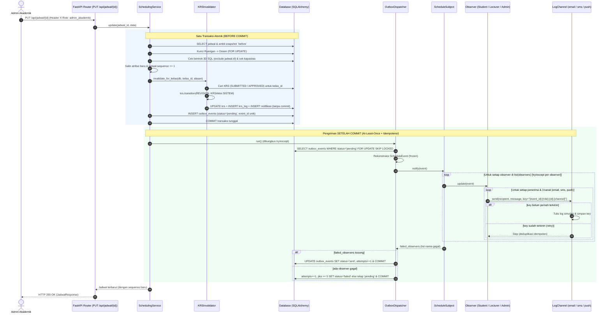

# UML Sequence Diagram — Observer Pattern & Transactional Outbox (Minggu 8)

Diagram di bawah menggambarkan alur aktual eksekusi `PUT /api/jadwal/{jadwal_id}` pada codebase SEVIMA Mini (`app/routers/jadwal.py`, `app/services/scheduling_service.py`, `app/services/krs_invalidator.py`, `app/services/outbox.py`, dan `app/services/schedule_observers.py`).

> **Titik Kritis untuk Viva:** Perhatikan bahwa `COMMIT` database terjadi **sebelum** `OutboxDispatcher.run()` dan `ScheduleSubject.notify()` dipanggil. Dengan begitu:
> 1. Jika validasi bentrok/kapasitas gagal atau `COMMIT` gagal, **tidak pernah** ada notifikasi yang terkirim untuk perubahan yang tidak pernah terjadi.
> 2. Jika pengiriman notifikasi atau salah satu observer mengalami error setelah `COMMIT`, perubahan jadwal yang sah **tidak pernah dibatalkan**, dan baris `outbox_events` tetap berstatus `pending` untuk dicoba ulang (maks. 5 kali) dengan kunci idempotensi agar tidak terjadi pesan ganda.

## Kesesuaian dengan Kode Aktual

- **Wiring singleton saat aplikasi start:** `init_default_schedule_subject()` dipanggil di `lifespan` (`app/main.py`) sehingga `StudentObserver`, `LecturerObserver`, dan `AdminObserver` hanya di-`attach` **sekali** saat server hidup (menghindari memory leak & notifikasi berulang).
- **Alur `DELETE /api/jadwal/{id}`:** mengikuti urutan identik (invalidasi KRS + hapus jadwal + `INSERT outbox_events` bertipe `schedule_deleted` → `COMMIT` → `OutboxDispatcher.run()`).
- **Alur Conflict Resolver UI (Tombol Terapkan):** tidak memiliki jalur khusus — tombol **Terapkan** memanggil `PUT /api/jadwal/{id}` yang sama persis dengan diagram di atas (prinsip satu pintu).
